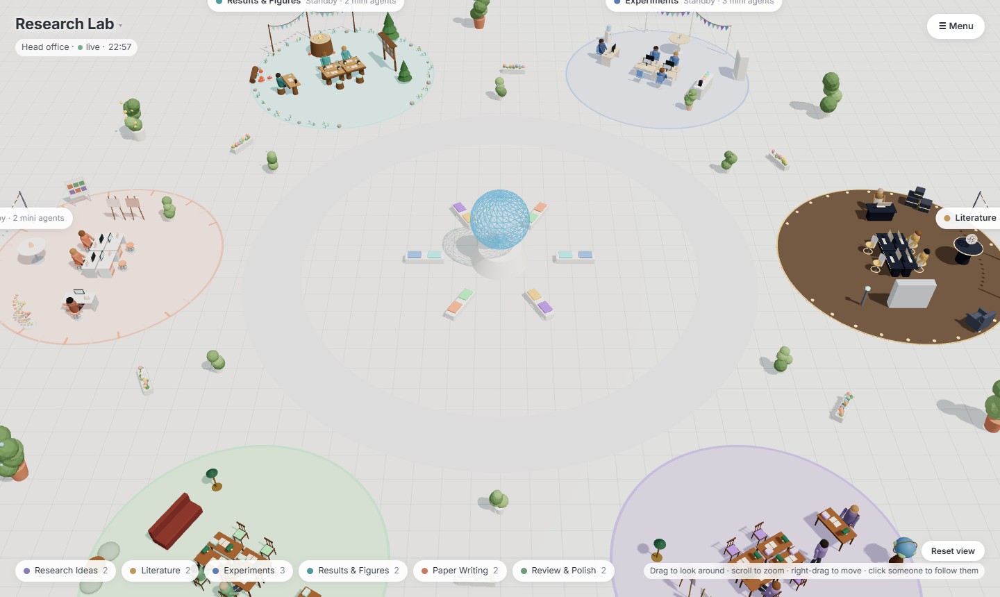
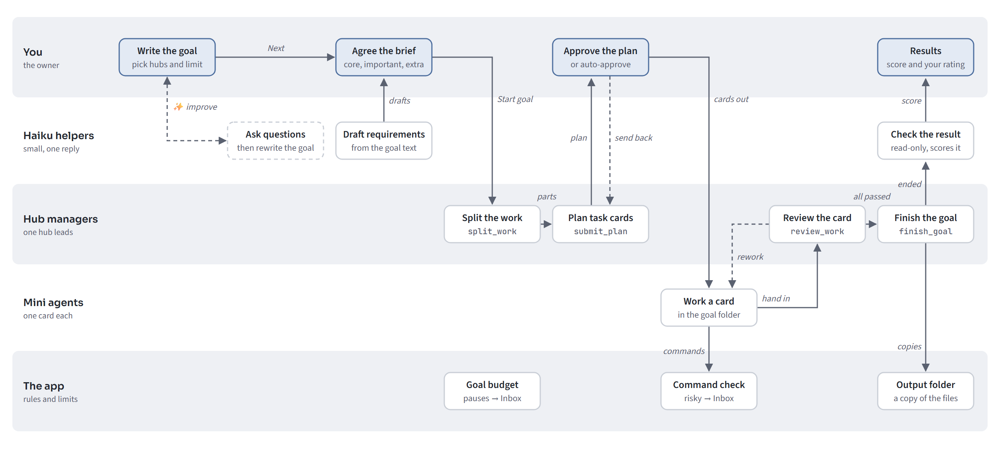
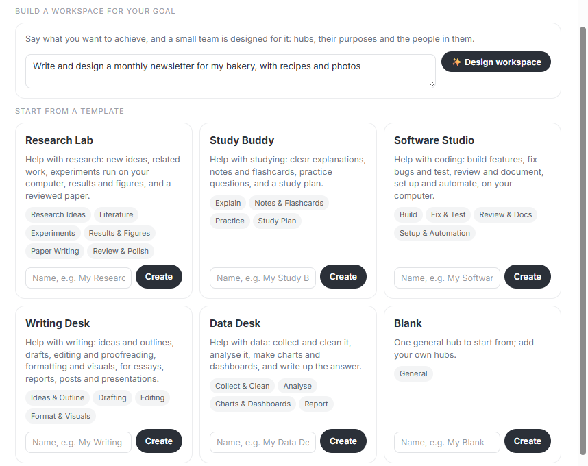
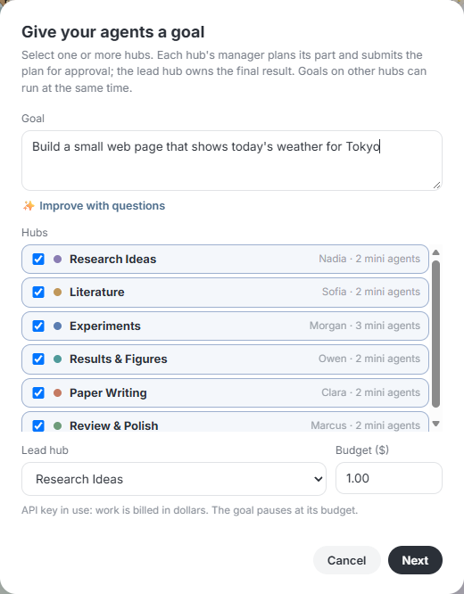

# Notice
The README and MANUAL will be updated soon.

# Intern Co.

Intern Co. is an in-development project that gets the most out of AI agents while keeping costs as low as possible. It runs a small office of Claude agents on your own computer: you set a goal, approve the plan, and watch teams do the work in a live 3D office.



Main features:

- **Prompt builder** 
- **Hubs**
- **Task cards**
- **Parallel goals and agents**
- **Goal scoring and KPIs**

## Background and purpose

Token usage has been rising as newer AI models become more capable. AI tools are now widely used, but agents often repeat the same work, which wastes tokens and leads to results nobody asked for.

Intern Co. divides AI agents into hubs. Each hub has a manager that breaks large tasks into small task cards. The hub's mini agents work on these cards, on a cheaper model if you choose one, and the manager reviews each result. You see every plan and approve or reject it before any work starts, unless you turn on automatic approval.

## How it works



You write the goal and agree its requirements. The lead manager splits the work between hubs, and each manager sends you a plan of task cards. Once you approve, mini agents work their cards and managers pass them or send them back. When every card has passed, the result is scored and the files are copied to your output folder.

| Build a workspace for your goal | Start a goal |
|---|---|
|  |  |


## Algorithm map

(Under development)

## Tech stack

| Area | Tools |
|---|---|
| Agents | Python, `asyncio`, Claude Agent SDK, Claude Code |
| App server | NiceGUI, FastAPI |
| Interface | JavaScript, Three.js for the 3D office |
| Data | SQLite |
| Desktop window | pywebview |

## Before you start

You need:

- Python 3.10 or newer
- [Claude Code](https://code.claude.com/docs/en/overview)
- Your own Anthropic API key from [console.anthropic.com](https://console.anthropic.com)

**Intern Co. runs only on your own API key.** No key is included, and the app does not store yours. Usage is billed to your Anthropic account, so set budgets you are comfortable with. Each goal has its own budget and pauses when it reaches it.

Keep your key private. Never put it in a file you share or commit.

## Install and run

Download the code:

```
git clone https://github.com/Jasonda-hue/intern-co.git
cd intern-co
```

**Windows.** Run these once in a terminal, then run `Intern Co.bat`:

```
pip install -r requirements.txt
setx ANTHROPIC_API_KEY "your-key"
```

`setx` saves the key for every program on your computer, so other Claude Code use on it is billed to the key too.

**Mac.** Run `bash setup-mac.command` once, then start the app from Terminal with your key set:

```
export ANTHROPIC_API_KEY="your-key"
bash "Intern Co.command"
```

The first account you create becomes the owner. It is an account for this app only. `MANUAL.md` has the full guide, and it can also be read inside the app.

## Safety

Agents can run commands on your computer automatically.
Read commands before you allow them, and use the app at your own risk.

## Your data

Accounts, goals and files stay in the `data` folder on your computer. Never share that folder. It is not part of this repository.

## Status

In development. Built and tested on Windows; the Mac version has not been run on a Mac yet. 

## Author

Jason D Anderson, The University of Electro-Communications (電気通信大学大学院), Graduate School

## License

[MIT](LICENSE)

Intern Co. is an independent project, not affiliated with or endorsed by Anthropic. Claude is a trademark of Anthropic.
