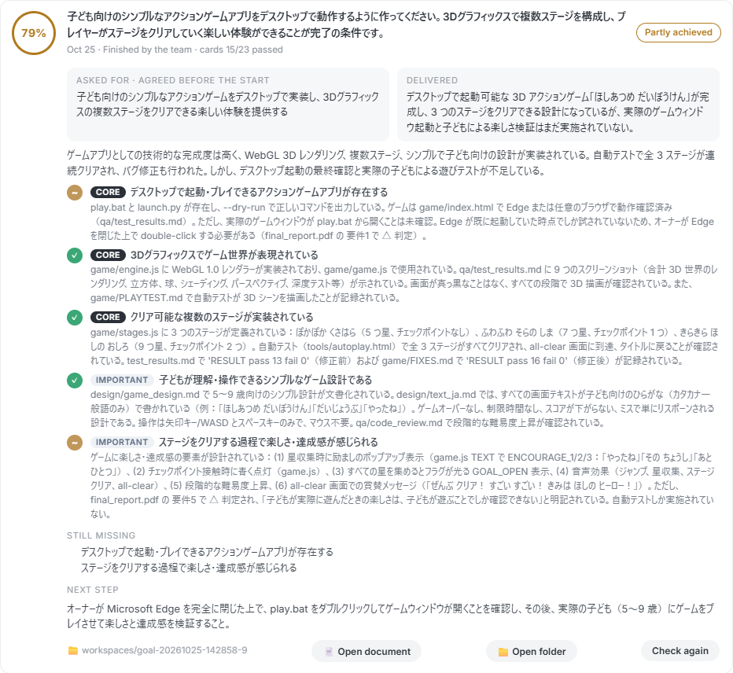

# Intern Co.

Run a small office of AI agents on your own computer. Set a goal, approve the plan, and watch Claude-powered teams do the work in a live 3D office.


Intern Co. turns Claude into a team that works on your computer. Choose a ready-made workspace, or describe your aim and have one designed for you. Give it a goal, and hub managers split the work into task cards for mini agents. Nothing starts until you approve the plan, unless you turn on automatic approval.

- Watch the work happen in a live 3D office
- Review each plan, and decide on risky commands from your Inbox
- Set a budget for each goal, and pause or continue goals
- See each finished goal scored against its requirements
- Use it in English or Japanese

## Why I built this

I wanted AI agents to work like a small team I could manage, instead of one long chat I had to watch. Three ideas shaped the design:

- **People stay in charge.** Managers plan and mini agents do the work, but the plan needs approval first. Mini agents only talk to their own manager and teammates, and only managers talk across hubs.
- **Usage stays low.** Each agent is a separate process that costs money, so only agents with work run, idle sessions close, and task cards stay small. Helper sub-agents are off by default: in a measured test, one agent reading five files used about half as much as the same agent with five helpers.
- **The result gets checked by someone else.** Requirements are agreed before work starts. When the goal ends, a separate read-only checker scores the delivered files against them.

## How it works


You write the goal and agree its requirements. The lead manager splits the work between hubs, and each manager sends you a plan of task cards. Once you approve, mini agents work their cards and managers pass them or send them back. When every card has passed, the result is scored and the files are copied to your output folder.

| Build a workspace for your goal | Start a goal |
|---|---|
|  |  |

**A finished goal, scored by the checker.** This goal asked, in Japanese, for a 3D action game for children. The checker gave it 79%: the 3D graphics, three stages and simple design were met, but it could not confirm that `play.bat` opens the game window, and no child has played the game yet.



## Tech stack

| Area | Tools |
|---|---|
| Agents | Python, `asyncio`, Claude Agent SDK, Claude Code |
| App server | NiceGUI, FastAPI |
| Interface | JavaScript, Three.js for the 3D office |
| Data | SQLite |
| Desktop window | pywebview |

**Engineering highlights:**

- Runs several goals at once, each with its own folder and budget, and limits how many agent processes run together
- Sorts every shell command into run, ask or refuse before it executes
- Limits file edits to the goal's own folder
- Checks for an API key at every point that starts Claude
- Translates the whole interface between English and Japanese, including messages from the server

## Before you start

You need:

- Python 3.10 or newer
- [Claude Code](https://code.claude.com/docs/en/overview)
- Your own Anthropic API key from [console.anthropic.com](https://console.anthropic.com)

**Intern Co. runs only on your own API key.** No key is included, and the app does not store yours. Usage is billed to your Anthropic account, so set budgets you are comfortable with. Each goal has its own budget and pauses when it reaches it.

Keep your key private. Never put it in a file you share or commit.

## Install and run

Download the code:

```
git clone https://github.com/Jasonda-hue/intern-co.git
cd intern-co
```

**Windows.** Run these once in a terminal, then double-click `Intern Co.bat`:

```
pip install -r requirements.txt
setx ANTHROPIC_API_KEY "your-key"
```

`setx` saves the key for every program on your computer, so other Claude Code use on it is billed to the key too.

**Mac.** Run `bash setup-mac.command` once, then start the app from Terminal with your key set:

```
export ANTHROPIC_API_KEY="your-key"
bash "Intern Co.command"
```

The first account you create becomes the owner. It is an account for this app only. `MANUAL.md` has the full guide, and it can also be read inside the app.

## Safety

Agents can run commands on your computer:

- Reading and testing inside a goal's own folder runs without asking. You can turn this off in Settings.
- Commands that install, download, delete or change things outside that folder wait for your approval.
- Stopping programs, starting servers and shutting down the computer are always refused.
- File edits are only allowed inside the goal's own folder.

These checks reduce risk but do not remove it. Read commands before you allow them, and use the app at your own risk.

## Your data

Accounts, goals and files stay in the `data` folder on your computer. Never share that folder. It is not part of this repository.

## Status

Developed on Windows. The Mac version has not been run on a Mac yet. Google sign-in is optional and needs your own Google OAuth client; see `MANUAL.md`, section 12.

## Author

Jason D Anderson, 電気通信大学大学院

## License

[MIT](LICENSE)

Intern Co. is an independent project, not affiliated with or endorsed by Anthropic. Claude is a trademark of Anthropic.
